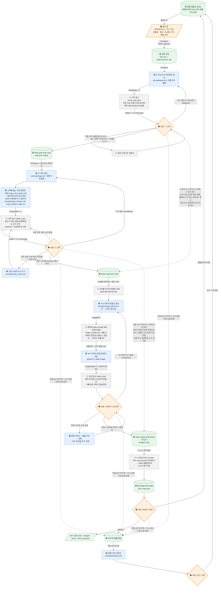
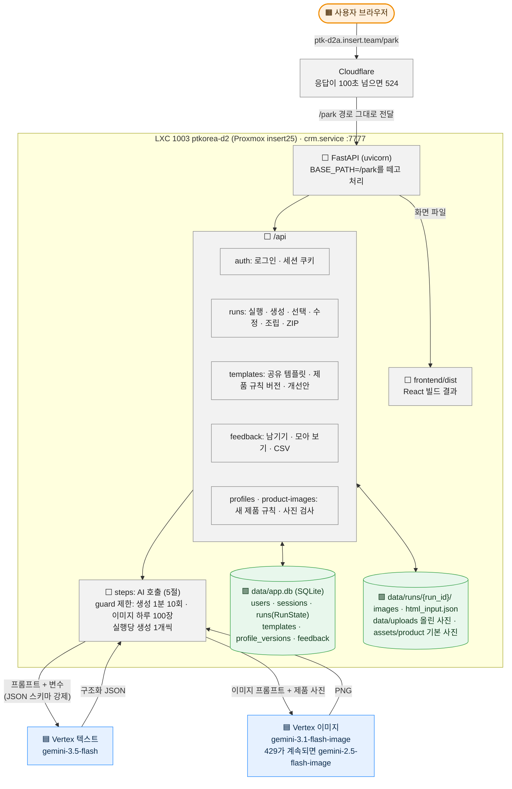
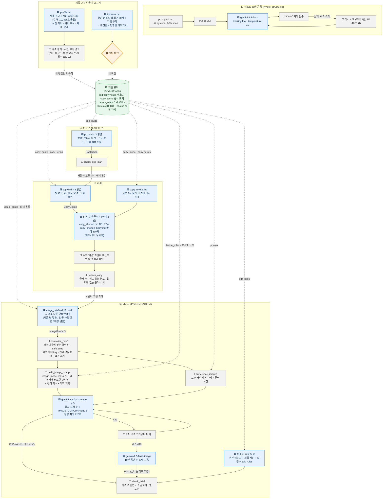

# 흐름도

각 단계에서 **AI가 3개 안을 만들고 → 코드가 규칙을 검사하고 → 사람이 하나를 골라(고쳐서) → 고른 결과만 다음 단계로 넘어가는** 구조다.
데이터 형식은 [data-format.md](data-format.md), 실행 방법은 [setup.md](setup.md).

## 1. 전체 흐름

범례: 🟦 AI 생성 · ⬜ 코드 처리 · 🟧 사람이 선택하는 지점 · 🟩 저장되는 데이터 · 실선 화살표 = 데이터 이동 · 점선 = 되돌아가기

> GitHub, VS Code(Markdown Preview Mermaid Support), Notion에서 그림으로 보인다. 그림이 안 보이는 곳에서는 아래 3·4절의 표가 같은 내용이다.

## 2. 시스템 구성

범례: 🟧 사람 · ⬜ 서버 코드 · 🟦 AI(Vertex) · 🟩 저장소

- 계정·실행·템플릿·피드백은 서버마다 있는 `app.db`에 있다. git에 올라가지 않아서 로컬과 배포 서버는 서로 다른 데이터를 쓴다.
- 화면은 상태를 따로 들고 있지 않는다. 모든 API가 실행 전체 상태(`RunState`)를 돌려주고, 화면은 그걸 그대로 그린다. 이미지는 한 장씩 끝날 때마다 저장되고, 화면은 생성 중에 실행을 다시 읽어 보여준다.
- 로컬 개발: React 개발 서버(localhost:5173)가 `/api`를 FastAPI(localhost:8000)로 넘긴다. 모델 없이 확인할 때(`LLM_PROVIDER=mock`, `IMAGE_PROVIDER=placeholder`)는 고정 예시와 SVG 자리표시 이미지를 쓴다.

## 3. 단계별 입력 → 출력 → 사람의 선택

| 단계 | 받는 데이터 (어디서) | AI·코드가 하는 일 | 내보내는 데이터 | 사람이 하는 일 |
|---|---|---|---|---|
| 입력 | — | `RunInput` 검증 (스펙이 하나도 없으면 422) | `RunInput` → DB `runs` | 폼 작성 후 시작 |
| ① Pod 순서·레이아웃 | `RunInput` | 방향 3개로 3번 병렬 생성 → `check_pod_plan` | `PodOption` 3안 + 경고 | 1안 선택 / 블록으로 순서·레이아웃 직접 수정 / 수정 요청 넣어 재생성 |
| ② 카피 | `RunInput` + ①에서 **선택한** Pod 순서·레이아웃 | 3번 병렬 생성 → 20자 넘은 헤드·110자 넘은 바디만 줄이기 → `check_copy` | `CopyOption` 3안 + 경고 | 1안 선택 / 헤드·바디 직접 수정 / Pod 여러 개(전체) 골라 수정 요청 / 재생성 |
| ③ 이미지 | `RunInput` + ①의 Pod별 레이아웃 + ②에서 **선택한** Pod별 헤드·바디 | Pod마다: 연출안 3개 → 화면비·Safe Zone 고정 → P2 프롬프트 + 제품 사진으로 이미지 생성 → `check_brief` | Pod별 `ImageOption` 3안 (× Pod 수) | Pod마다 1안 선택 / 이미지 한 장 수정 요청(새 안 추가) / 그 Pod만 재생성 |
| ④ 조립 | ①②③에서 **선택한** 결과 전부 | `build_html_input` → Jinja2 템플릿(P3 규칙) | `html_input.json` + 최종 HTML | 미리보기 확인 → ZIP 저장 |

## 4. 단계 사이의 규칙

| 규칙 | 동작 | 이유 |
|---|---|---|
| 앞 단계를 고르기 전엔 다음 단계 생성 불가 | API가 400 | 뒤 단계는 사람이 고른 앞 단계 결과를 전제로 만든다 |
| 앞 단계를 다시 생성하면 뒤 단계 초기화 | `reset_after()`가 뒤 단계와 HTML을 비움. 화면은 먼저 확인창을 띄움 | 고를 안 자체가 새로 바뀐다 |
| 앞 단계를 다시 선택·직접 수정·수정 요청하면 뒤 단계 유지 | `_apply_change()`: ② 카피안의 Pod 순서를 ①에 맞추고, 영향받은 ③ 이미지에 `stale` 표시, 조립된 ④는 다시 조립 | 이미지까지 만든 뒤 조금 고칠 때마다 전부 다시 만들면 시간·비용이 크다. 카피·이미지는 Pod 이름으로 묶여 있어 순서가 바뀌어도 쓸 수 있다 |
| ③은 모든 Pod를 골라야 완료 | 한 Pod라도 비면 ④ 조립 불가 (400) | 최종 시안에 빈 Pod가 생기면 안 된다 |
| 한 실행에서 생성은 한 번에 하나 | 409 | 동시에 돌면 호출이 두 배가 되고 진행 상태를 서로 덮어쓴다 |
| 생성 요청 1분 10회, Vertex 이미지 하루 100장 | 429 / 생성 전에 거절 | 반복 호출·비용 폭주 방지 |
| 3안 중 일부만 실패 | 성공한 안만 보여줌. 모두 실패해야 502 | 한 안의 일시 오류로 단계 전체를 다시 돌리지 않게 |

## 5. AI 호출 상세

AI 호출은 모두 회사 GCP의 Vertex AI로 간다. 텍스트는 `invoke_structured()`가 프롬프트(`backend/app/prompts/*.md`)에 변수를 채워 보내고, 응답은 JSON 스키마로 강제해 받는다. 숫자는 `.env` 기본값이다.

범례: 🟦 AI 호출 · ⬜ 코드 처리 · 🟩 제품 규칙(템플릿) · 점선 = 제품 규칙이 끼워 넣는 내용

| 호출 | 프롬프트 | 한 번 생성에 부르는 횟수 | 결과 스키마 | 호출 뒤 코드가 하는 일 |
|---|---|---|---|---|
| ① Pod 순서·레이아웃 | `pod.md` | 3번 (방향마다, 병렬) | `PodOption` | `check_pod_plan` |
| ② 카피 | `copy.md` | 3번 (병렬) + 넘친 안마다 줄이기 최대 2번씩 | `CopyOption` | 줄인 결과의 수치·조건 확인 → `check_copy` |
| ② 카피 수정 | `copy_revise.md` | 1번 (고른 Pod 전부) + 줄이기 | `RevisedPods` | 같은 검사 |
| ③ 연출안 | `image_brief.md` | Pod마다 1번 (3안을 한 번에, 안끼리 겹치지 않게) | `ImageBriefs` | 없는 제품 상태면 실패 처리 → `normalize_brief` |
| ③ 이미지 | `image_model.md` 골격 + 제품 규칙 | Pod마다 3장 | PNG | 끝나는 대로 저장 → `check_brief` |
| ③ 이미지 수정 | 코드 안 편집 프롬프트 + `edit_rules` | 요청마다 1장 | PNG | 새 안으로 추가·선택 |
| 새 제품 규칙 | `profile.md` (사진 입력) | 1번 | `ProductProfile` | 규격 검사·사진 부족 경고 |
| 규칙 개선안 | `improve.md` | 1번 | `ProposalDraft` | 승인 전까지 쓰지 않음, 승인하면 반영한 피드백을 "반영함"으로 |

- ④ 조립과 사진 검사(`image_check.py`)는 AI를 쓰지 않는다.
- 각 단계의 3안 중 일부만 실패하면 성공한 안만 보여준다. 모두 실패해야 오류가 난다.
